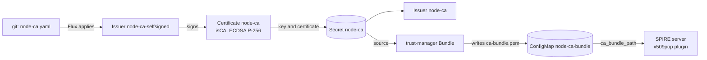
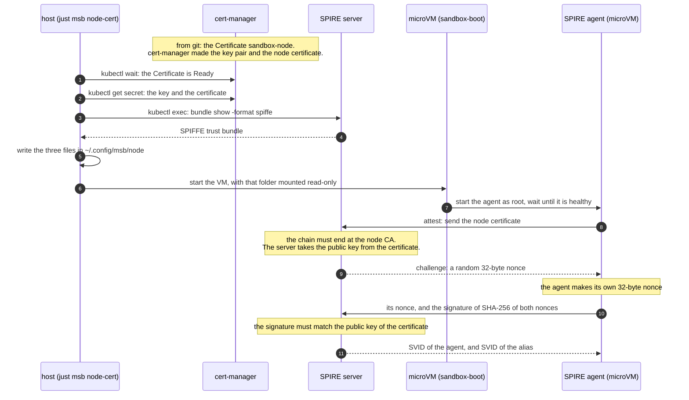
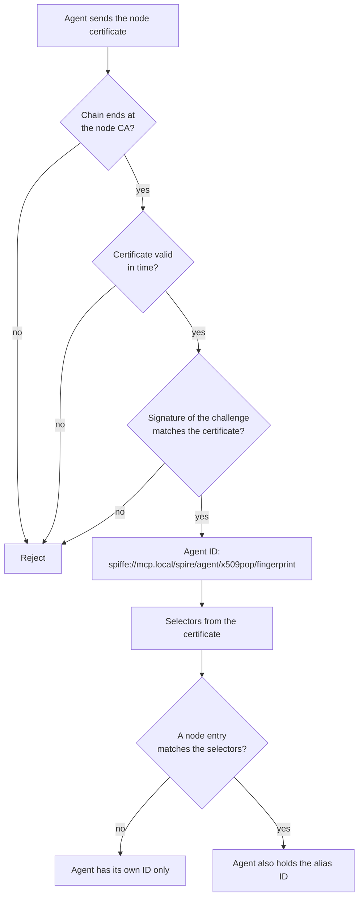

# Zero trust: node attestation

> **Status: design.** The microVM of the msb sandbox does not attest yet. This page describes the target flow with the SPIRE node attestor `x509pop`. Section 10 shows which parts exist. The join-token flow of the Docker sbx sandbox is in the git tag [`docker-sbx`](https://github.com/raghav19/engineersdaybook/tree/docker-sbx).

## 1. What node attestation is

Node attestation is the first proof in SPIRE. A node proves who it is to the SPIRE server. The server then issues an SVID to the SPIRE agent of that node.

In part 3, the node is the sandbox microVM. The agent that runs in the microVM joins the SPIRE server of the Kubernetes (k8s) cluster. It shows a certificate that a CA of this cluster signed. It also proves that it holds the private key of that certificate.

Workload attestation comes after it. A process on the node asks the agent for an SVID, and the agent checks the process. This page covers only the node step.

## 2. The problem and the purpose

The gateway must serve only trusted callers. A JWT proves the user. It does not prove the machine. A stolen JWT works from any machine.

Node attestation adds the machine. A call that comes from an unknown microVM has no SVID, so it can fail at the gateway. The node proof is the first guardrail of the chain.

Zero trust asks for the same thing. No network position gives trust. Each caller proves its identity, and a policy decides the access. This is the tenet of dynamic policy in NIST [CSWP 20](https://nvlpubs.nist.gov/nistpubs/CSWP/NIST.CSWP.20.pdf), which repeats SP 800-207.

Node attestation alone blocks no call. It makes the identity. A gateway policy must use it.

## 3. Terms

| Term | Meaning here |
|---|---|
| SPIFFE ID | A URI that names an identity. Example: `spiffe://mcp.local/spire/agent/x509pop/<fingerprint>`. |
| SVID | A short-lived X.509 certificate that carries a SPIFFE ID. The SPIRE server signs it. |
| SPIRE server | The CA of the trust domain `mcp.local`. It runs in the k8s cluster, in the namespace `spire-system`. |
| SPIRE agent | It runs on the node, here in the microVM. It attests the node, then the workloads on it. |
| Node CA | A CA that signs node certificates only. It is not the CA of the SPIRE server. cert-manager makes it. |
| CSR | cert-manager | Inside cert-manager, and a copy in the `CertificateRequest` | Public |
| Node certificate | cert-manager | The same Secret, the same folder, and the `CertificateRequest` | Public. It is useless without the key. |
| Proof of possession | The agent signs a challenge with its private key. Only the holder of the key can do this. |
| Nonce | A random 32-byte value. The server makes one and the agent makes one. The agent signs the hash of both. |
| Node CA bundle | The certificate of the node CA. The SPIRE server uses it to check node certificates. |
| SPIFFE trust bundle | The SPIRE server | `~/.config/msb/node` on the host, and the read-only mount in the microVM | Public |
| Selector | A fact that the server learns about an attested node. Example: `x509pop:subject:cn:microvm-123`. |
| Node entry (alias) | A registration entry that gives a node a fixed SPIFFE ID. The server picks the node by its selectors. Workload entries use it as parent. |

## 4. The flow


### The parts

| Part | Where | Job |
|---|---|---|
| cert-manager | `cert-manager` namespace | Makes the node CA, and signs a node certificate for each request. |
| Node CA objects | `spire-system`, from git | An `Issuer`, a CA `Certificate` and the `Issuer` `node-ca`. |
| trust-manager | `spire-system`, in the spire addon | Copies the node CA certificate into a ConfigMap. It reads Secrets only in `spire-system`, and it writes ConfigMaps only there. |
| SPIRE server | `spire-system` | Checks the node certificate with the `x509pop` plugin. |
| Istio ingress gateway | `istio-ingress` | Passes the TLS of the agent through to the SPIRE server. It reads only the SNI name `spire.localhost`. The host port is 443. |
| Certificate `sandbox-node` | `spire-system`, from git | Asks cert-manager for the key pair and the 90-day node certificate of the microVM. The node CA signs it. cert-manager renews it 30 days before its end. |
| `just msb node-cert` | host | Before the VM starts, it waits until the node certificate is Ready. Then it copies the key, the certificate and the trust bundle into `~/.config/msb/node`. |
| `sandbox-boot` | microVM | Starts the SPIRE agent as root and waits until it is healthy. |
| SPIRE agent | microVM | Reads the key and the certificate from the read-only mount `/run/sandbox/node`. Sends the certificate and signs the challenge. It reaches the server at `spire.localhost`, on port 443 of the host. The gateway of the host passes the TLS through to the server. |

### Stage A: setup, once

Flux applies these steps from git. Nobody types a command.



1. Flux applies `node-ca.yaml`. A self-signed `Issuer` signs the CA `Certificate`. The result is the Secret `node-ca`.
2. The `Issuer` `node-ca` uses that Secret to sign other certificates.
3. A trust-manager `Bundle` copies the CA certificate (not the key) into the ConfigMap `node-ca-bundle`.
4. The SPIRE server mounts the ConfigMap. Its `x509pop` plugin reads it as `ca_bundle_path`.
5. Flux applies `node-certificate.yaml`. cert-manager makes an ECDSA P-256 key pair and a CSR for the microVM. The Issuer `node-ca` signs it. The key and the 90-day certificate are in the Secret `sandbox-node-tls`. The CN is the sandbox name and the URI SAN has the GitHub login.

### Stage B: each VM start



1. Before the VM starts, `just msb node-cert` runs on the host. It waits until the `Certificate` `sandbox-node` is Ready. If it is not, the VM does not start.
2. The host copies the key and the certificate from the Secret `sandbox-node-tls`. It reads the SPIFFE trust bundle from the SPIRE server. It writes the three files in `~/.config/msb/node` (the key has mode 600).
3. The host starts the VM. The VM mounts the folder read-only at `/run/sandbox/node`.
4. `sandbox-boot` starts the SPIRE agent as root and waits 30 seconds until the agent is healthy. If it is not healthy, `just msb run` stops.
5. The agent reads the key and the certificate. It sends the node certificate to the server. This is the first message. The server checks that the chain ends at the node CA. It takes the public key from the certificate.
6. The server sends a challenge: a random 32-byte nonce. It sends the challenge only after the chain check passes.
7. The agent makes its own 32-byte nonce. It signs the SHA-256 hash of both nonces with the node private key. It sends its nonce and the signature.
8. The server makes the same hash from the two nonces. It checks the signature with the public key from step 5.
9. The server issues the SVID of the agent. A node entry that matches the selectors also gives the alias SVID.

### Stage C: after the attestation

- The agent attests again by itself. Its own SVID is valid for 4 hours on this server (`default_x509_svid_ttl` in the server configuration). About half-way, the agent rotates it. The `x509pop` plugin allows re-attestation, so the rotation runs the full attestation again (steps 5 to 9). The agent reads the key and the certificate from the folder each time.
- So the node certificate must be valid at all times, not only at the start. If it expires, the rotation fails. When the SVID of the agent then expires, the agent has no identity.
- cert-manager renews the certificate when 30 days remain, and a new key comes with it. `just msb node-cert` copies the new files at each `just msb run`. For a VM that runs more than 60 days without `run`, run `just msb node-cert` on the host.
- A running agent stays as it is. A new agent starts with an empty data folder, so it attests at each start.
- The agent ID has the SHA1 fingerprint of the certificate. A renewed certificate gives a new agent ID. The old agent IDs stay in the server until they expire or you evict them.

## 5. What the server checks



The agent ID has the SHA1 fingerprint of the certificate. It changes with each new certificate. This is why the workload entries use the alias as parent and not the agent ID.

### The two signatures

| | On the certificate | On the challenge |
|---|---|---|
| What the signature covers | The node certificate: the public key of the VM and the name | The SHA-256 hash of the server nonce and the agent nonce |
| Signed by | The node CA key (cert-manager) | The node private key (the agent, in the VM) |
| When | Once, when the host applies the `CertificateRequest` | At each attestation |
| Checked with | The node CA certificate in `ca-bundle.pem` | The public key in the node certificate |
| What it proves | The node CA agreed to link this public key to this name | The sender holds the private key now |

The server first trusts the public key, because the node CA signed the certificate. Then it uses that key to check the signature of the challenge. Each check alone is not enough. A copy of the certificate fails the second check. A self-made certificate fails the first.

The server needs no list of node certificates. The certificate comes in the first message of each attestation. Trust comes from the node CA, so a new VM needs no change on the server. The server never holds the node CA private key. Only cert-manager holds it.

The selectors that the plugin gives (SPIRE v1.15.3):

| Selector | What it says | Source in the certificate |
|---|---|---|
| `x509pop:subject:cn:<name>` | The name of the VM. | Common name |
| `x509pop:san:<key>:<value>` | A fact, such as the GitHub id. | A URI SAN of the form `x509pop://mcp.local/<key>/<value>` |
| `x509pop:ca:fingerprint:<sha1>` | The CA that signed it. | Each certificate of the chain after the leaf |
| `x509pop:serialnumber:<hex>` | The leaf certificate. | Serial number |

The values are only as trustworthy as the rule that issues the certificate. See section 8.

In this repo, the node certificate has two names:

| Field | Value | Selector |
|---|---|---|
| CN | The sandbox name (`MSB_NAME`, `sandbox-dev` in the justfile) | `x509pop:subject:cn:sandbox-dev` |
| URI SAN | `x509pop://mcp.local/github-id/<login>` | `x509pop:san:github-id:<login>` |

A node entry that lists both selectors matches only a node that has both values. The SAN gives no part of the agent ID. The ID still comes from the fingerprint of the certificate.

## 6. Who holds what

| Item | Made by | Where it lives | Who can read it |
|---|---|---|---|
| Node CA key | cert-manager | Secret `node-ca` in `spire-system` | cert-manager, and every user who can read Secrets in `spire-system` |
| Node CA certificate | cert-manager | The Secret, and the ConfigMap `node-ca-bundle` | Public |
| Node private key | cert-manager | The Secret `sandbox-node-tls` in `spire-system`, a copy in `~/.config/msb/node` on the host, and a read-only mount in the microVM | cert-manager, every user who can read Secrets in `spire-system`, the user of the host, and root in the microVM |
| CSR | The host | Only in memory, and a copy in the `CertificateRequest` | Public |
| Node certificate | cert-manager | The same folder, and the `CertificateRequest` | Public. It is useless without the key. |
| SPIFFE trust bundle | The SPIRE server | The same folder | Public |
| SVID of the agent, and its key | The SPIRE agent | The data folder of the agent in the microVM, owned by root | Root in the microVM |

## 7. Why x509pop

| | Join token | `sshpop` | `x509pop` |
|---|---|---|---|
| What the node shows | A one-time secret | An SSH certificate | An X.509 certificate |
| A copy of the proof works on another machine | Yes, once, until it expires | No. The node must hold the key. | No. The node must hold the key. |
| New secret for each start | Yes | No | No |
| Selectors for a node entry | None | None listed in the plugin docs | CN, SAN, CA fingerprint, serial number |
| Switch in the SPIRE Helm chart | `nodeAttestor.joinToken` | None (checked in chart 0.30.3, 0.30.4 and `main`) | `nodeAttestor.x509POP`, mode `externalPKI` |

`sshpop` is a built-in plugin of SPIRE, but the chart cannot turn it on. The chart option `customPlugins` accepts only external plugin binaries. `x509pop` has a chart switch and it gives selectors, so it fits this repo.

The model behind the node attestation is in [node-attestation.md](node-attestation.md).

## 8. Limits

- **The CA signs what the CSR asks for.** The `Certificate` in git sets the names. A user who can create a `Certificate` or a `CertificateRequest` in `spire-system` can ask for any name. The microVM mounts the admin kubeconfig of the k3s cluster today, so a process in the microVM can do this.
- **The CA key is a Secret in `spire-system`.** A user who can read Secrets there can sign any node certificate. The service account of trust-manager can read every Secret in `spire-system`, so it can read the key too.
- **The GitHub id is a claim of git.** The CA does not check it against GitHub. The `Certificate` `sandbox-node` holds it.
- **The node certificate lasts 90 days, and nothing revokes it.** The key is a Secret in `spire-system`, and a copy is a file on the host. If it leaks, remove the Secret with `kubectl -n spire-system delete secret sandbox-node-tls`. cert-manager makes a new key and certificate. Run `just msb node-cert` and restart the agent. The server still accepts the old certificate until it expires. A new node CA ends it for sure.
- **The key is a mounted file.** The agent runs as root, so that the user `agent` cannot read the key. No test checked the file modes that the microVM shows for the mount.
- **Evict does not block a node.** The node can attest again with the same certificate until it expires. The certificate life is 90 days here. A new node CA ends it for all nodes.
- **The plugin docs list no revocation check.**
- **A removed node keeps its SVID until it expires.**
- **The values of the selectors are only as good as the issuing rule.** The plugin trusts the CA.

## 9. See it on your machine

Each check belongs to one part of the chain. A check works when its part exists (section 10).

**Part 1: the node CA.** On the host:

```bash
kubectl -n spire-system get issuer,certificate
kubectl -n spire-system get secret node-ca -o jsonpath='{.data.tls\.crt}' | base64 -d | openssl x509 -noout -subject -dates
```

Expect `node-ca-selfsigned` and `node-ca` as `Ready`. Expect the subject `mcp.local node CA`.

**Part 2: the bundle.**

```bash
kubectl -n spire-system get configmap node-ca-bundle -o jsonpath='{.data.ca-bundle\.pem}' | openssl x509 -noout -subject
kubectl -n spire-system get configmap node-ca-bundle -o yaml | grep -c "PRIVATE KEY"
```

Expect the same subject as the CA. Expect `0` from the second command: the ConfigMap holds no private key.

**Part 3: the server.**

```bash
kubectl -n spire-system get configmap spire-server -o jsonpath='{.data.server\.conf}' | grep -A3 x509pop
```

Expect `mode` `external_pki` and the path of the bundle. Then check the route through the gateway:

```bash
kubectl -n istio-ingress get gateway,tlsroute spire
echo | openssl s_client -connect 127.0.0.1:443 -servername spire.localhost 2>/dev/null | openssl x509 -noout -ext subjectAltName
```

Expect the URI SAN `spiffe://mcp.local/spire/server`. A certificate from another CA means that a proxy ended the TLS before the server. Then check the node entry:

```bash
kubectl get clusterstaticentry sandbox-node -o jsonpath='{.status}'
kubectl -n spire-system exec spire-server-0 -c spire-server -- /opt/spire/bin/spire-server entry show -spiffeID spiffe://mcp.local/node/sandbox-dev
```

Expect the entry with the two selectors `x509pop:subject:cn:sandbox-dev` and `x509pop:san:github-id:raghav19`.

**Part 4: the key and the certificate.** On the host:

```bash
kubectl -n spire-system get certificate sandbox-node
stat -c %a ~/.config/msb/node/node.key
openssl x509 -in ~/.config/msb/node/node.crt -noout -subject -dates -ext subjectAltName
```

Expect `READY` `True`. Expect `600` for the key. Expect the CN `sandbox-dev`, the URI SAN `x509pop://mcp.local/github-id/<login>`, and an end date about 90 days ahead.

**Part 5: the agent.** In the microVM:

```bash
spire-agent healthcheck -socketPath /run/spire/agent.sock
grep -E "Node attestation was successful|Successfully reattested node" /var/log/spire-agent.log
```

On the host, list the attested agents:

```bash
kubectl -n spire-system exec spire-server-0 -c spire-server -- /opt/spire/bin/spire-server agent list
```

Expect `spiffe://mcp.local/spire/agent/x509pop/<fingerprint>` and the selectors of section 5.

**Two tests that must fail:**

1. Remove the node certificate in the microVM and restart the agent. The attestation must fail.
2. Sign a certificate with another CA and use it in the microVM. The server must reject it.

To remove the node, evict it on the host. Then wait for the node certificate to expire:

```bash
kubectl -n spire-system exec spire-server-0 -c spire-server -- /opt/spire/bin/spire-server agent evict -spiffeID <agent SPIFFE ID>
```

## 10. Status of the chain

| # | Part | State |
|---|---|---|
| 0 | This page and the diagrams | done |
| 1 | The node CA (cert-manager) | done |
| 2 | trust-manager and the node CA bundle | done |
| 3 | `x509pop` on the SPIRE server, and the node entry | done |
| 4 | The agent config, the read-only mount and the agent start in the microVM, and the port rule of `msb.py` | done |
| 5 | The Certificate `sandbox-node` and `just msb node-cert` on the host: the key pair, the 90-day certificate and the bundle | done |
| 6 | Cleanup of the other pages | planned |

## 11. Setup of the SPIRE server and agent


