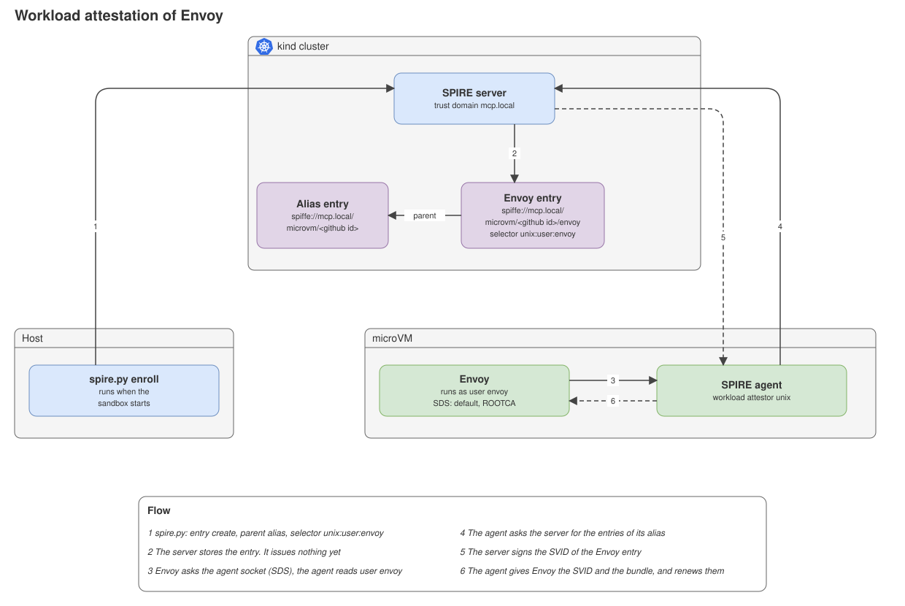
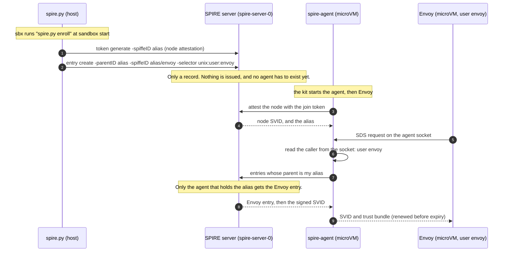

# Zero trust: workload attestation

## 1. What workload attestation is

Workload attestation is the second proof in SPIRE. The first proof is [node attestation](zero-trust-node-attestation.md): the microVM proves who it is, and the SPIRE agent gets its SVID. Now a process on that node asks the agent for an SVID, and the agent checks the process.

In part 3, the process is Envoy in the sandbox microVM. It gets the SVID `spiffe://mcp.local/microvm/<github id>/envoy`. No other process of the microVM gets one.

## 2. The problem and the purpose

The node SVID belongs to the SPIRE agent. A client call does not carry it. So the gateway cannot use it to check the caller.

A workload SVID can be on a call. Envoy holds it, and the SVID key stays in Envoy and not in the coding agent. The SPIRE server signs it only for an agent that it attested as the node. So an SVID of Envoy shows that the call comes from the microVM of this user.

This page covers the issue of the SVID only. Envoy has no listener and no upstream yet, so the identity blocks no call. A gateway policy on the SPIFFE ID must use it.

## 3. Architecture



### Flow



## 4. Setup

| What | Where |
|---|---|
| The entry. Parent: the alias. SPIFFE ID: the alias and `/envoy`. Selector: `unix:user:envoy`. `enroll` creates it when it is missing, also when it makes no new token. | `.sbx/agent/spire.py`, `register_workload` |
| Envoy 1.40.1, a pinned release binary. | `.sbx/kits/dev-tools/tools.toml` |
| The Envoy config: admin on `127.0.0.1:9901`, a cluster for the agent socket, and a placeholder upstream that takes the SVID (`default`) and the trust bundle (`ROOTCA`) over SDS. | `.sbx/kits/dev-tools/envoy.yaml` |
| The kit creates the user `envoy` (no home, no login) and starts Envoy as that user, after the agent. The log is `/var/log/envoy.log`. | `.sbx/kits/dev-tools/dev-tools.yaml` |

The SDS name `default` is the one SVID of the workload. No GitHub id is in the image.

## 5. Who gets the SVID

Two parts of the entry decide it:

- **The parent says which node.** The parent is the alias, not the agent ID. The agent ID holds the join token and changes at each enrolment. The alias is fixed by the GitHub id, so the entry survives a new token. The server gives an entry only to the agent that holds its parent.
- **The selector says which process on that node.** The agent reads the Unix user of the caller on the socket. `unix:user:envoy` matches only a process of the user `envoy`.

Another user has another alias. Their agent never receives this entry, and a process called `envoy` on their microVM matches their entry. The GitHub id is in the SPIFFE ID, so the gateway can see whose Envoy it is.

Limits:

- **Whoever holds the join token becomes the alias.** The token is one-time and lasts 10 minutes, but it is a bearer secret.
- **The GitHub id is a claim of the host.** `spire.py` reads `SANDBOX_GITHUB_ID` and nothing checks it against GitHub. A better node attestor, `x509pop`, can make it a checked claim (see [node attestation](zero-trust-node-attestation.md#5-a-better-node-attestor-x509pop)).
- **Any process that runs as `envoy` gets the SVID.** Only Envoy may run as that user. `unix:path` and `unix:sha256` would also tie the SVID to the binary. They are not set yet.
- **The agent socket allows all users.** A process of another user gets no SVID, because it matches no entry.
- **Two microVMs of one user share the alias.** The gateway can tell the user apart but not the microVM.
- **A removed node keeps its SVID until it expires.** An evicted node gets no new SVID. The SVIDs it holds last for their lifetime.

## 6. See it on your machine

On the host, go to the root of the repo and run `enroll`. It also creates the Envoy entry. Use the numeric GitHub id of your account.

```bash
export SANDBOX_GITHUB_ID=$(gh api user --jq .id)
.sbx/agent/spire.py enroll
kubectl -n spire-system exec spire-server-0 -c spire-server -- /opt/spire/bin/spire-server entry show -parentID spiffe://mcp.local/microvm/$SANDBOX_GITHUB_ID
```

The list has the entry `spiffe://mcp.local/microvm/<github id>/envoy` with the selector `unix:user:envoy`.

In the microVM, ask for the SVID as the user `envoy` and as the user `agent`. `sudo` drops the `PATH`, so use the full path of `spire-agent`:

```bash
sudo -u envoy "$(command -v spire-agent)" api fetch x509 -socketPath /home/agent/.spire/agent.sock
spire-agent api fetch x509 -socketPath /home/agent/.spire/agent.sock
```

The first command returns the SVID of Envoy. The second returns `no identity issued`.

Check that Envoy holds the SVID and the trust bundle:

```bash
pgrep -u envoy envoy
curl -s 127.0.0.1:9901/certs
```

The output shows the SPIFFE ID of Envoy as the URI SAN of the certificate, and the CA certificates of the trust bundle.
