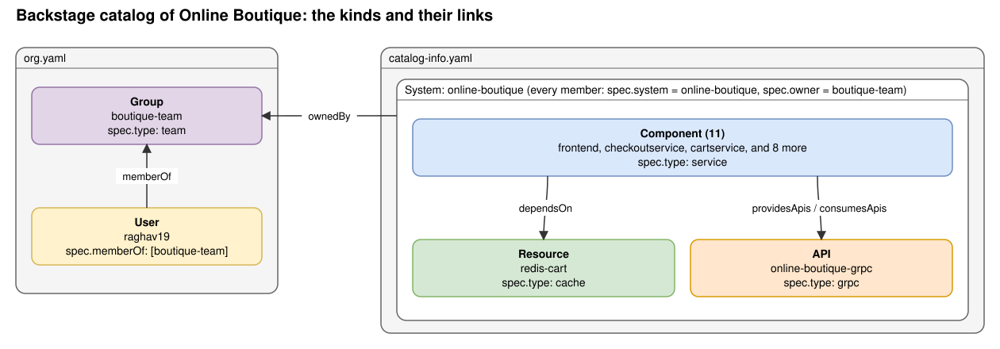

# Catalog of Online Boutique

This folder holds the files that describe Online Boutique for Backstage. The app team owns them. Backstage reads them from the branch `main`.

The diagram shows one box for each kind of entity. It shows the links between the kinds, not the links between the 11 services. A Component is one of 11 services, and the box stands for all of them.

Backstage has one catalog. The two files are two sources for that one catalog. Each entity links to the others by name, so the files can stay apart.

## The kinds we use

| Kind | What it is | Use it when | In our files |
|---|---|---|---|
| Group | An organizational entity: a team, a business unit, or a loose group of people. | You need an owner for software. Also when you want a tree of teams (`spec.parent`). | `boutique-team` (type `team`) |
| User | A person, such as an employee or a contractor. | You put people in groups. Later, you match a person to a GitHub login. | `raghav19` |
| System | A collection of components and resources that work together and expose one or more public APIs. | You want one name for a product that has many parts. | `online-boutique` |
| Component | A piece of software: a website, a backend service, a library, or a data pipeline. | You build or run it. Make one Component for each service. | 11 services, type `service` |
| Resource | The infrastructure a component needs at runtime: a database, a topic, a bucket, a cache. | You want to show what the software needs to work. | `redis-cart`, type `cache` |

## The four links

Each link starts as a field in the `spec` of one entity. Backstage turns the field into a relation. It also adds the reverse relation on the other entity.

| Link | Field in the YAML | Relation (and reverse) | In our files |
|---|---|---|---|
| Person to team | `spec.memberOf` on the User | `memberOf` (`hasMember`) | `raghav19` is a member of `boutique-team`. |
| Who owns it | `spec.owner` | `ownedBy` (`ownerOf`) | The System, the 11 Components, and the Resource name `boutique-team`. |
| Part of a system | `spec.system` | `partOf` (`hasPart`) | The 11 Components and the Resource name `online-boutique`. |
| Needs another entity | `spec.dependsOn` | `dependsOn` (`dependencyOf`) | `cartservice` depends on `redis-cart`. Four other Components depend on other Components. |

An entity reference has the form `[kind:][namespace/]name`, for example `group:default/boutique-team`. You can leave out the kind or the namespace when the context gives a default. The default namespace is `default`.

The group field `spec.children` lists child groups, not users. Our list is empty.

## Kinds we do not use yet

| Kind | What it is | Use it when |
|---|---|---|
| API | The boundary between components, in a machine-readable format. | A Component offers an interface. The Boutique services have gRPC `.proto` files, so each one could have an API entity. |
| Domain | A group of systems that share terminology, metrics, or a business purpose. | You have many systems. |
| Template | The form and the steps that make new software. | You use the scaffolder to create a service. |
| Location | A marker that points to other files with catalog data. | Backstage makes one for each URL in `catalog.locations`. |

## Your understanding, checked against the Backstage docs

| What you said | Verdict | What the docs say |
|---|---|---|
| `org.yaml` is a catalog of orgs. | Not exact | The descriptor format documents these kinds: Component, Template, API, Group, User, Resource, System, Domain, Location. It has no kind `Organization`. The file name is our choice. The entities in the file are a `Group` and a `User`. |
| It is a single org that Backstage manages. | Not exact | Backstage does not manage the entities. The YAML files are the source of truth, and Backstage reads them. The docs say the files are "maintained by the respective owners". |
| The group holds a set of users. | Right | You write the membership on the user (`spec.memberOf`, required). |
| The Boutique has another catalog. | Not exact | There is one catalog. `catalog-info.yaml` is one more file that feeds it. |
| Components map to services. | Partly right | A component is "a piece of software", here of the type `service`. It is not the Kubernetes Service. The annotation `backstage.io/kubernetes-label-selector` links it to the pods. |
| The System is the overarching app. | Right | Our system has no API entities yet. |
| The Resource is a dependency. | Right | A resource is the infrastructure "a component needs to operate at runtime". |
| Components have metadata with the group and the user they belong to. | Fix | The owner is `spec.owner`, not metadata. A component has one owner. The owner is a group (the default) or a user. Our files name the group only. The user connects through the membership. |
| Ownership and dependency are one mapping. | Fix | They are two fields with two meanings: `spec.owner` and `spec.dependsOn`. |

The docs also say what ownership is for. The owner is the "point of contact if something goes wrong". The docs say the owner is for people to read. It is "not to be used by automated processes to for example assign authorization in runtime systems".

## What I did not check

- How the Backstage UI finds "my components" for a signed-in user. I expect it uses the group membership of the user. The docs I read do not say so.
- Which plugin shows which relation in the UI. The docs say plugins read the relations "as needed".

## Sources

I read these pages from the Backstage repo (`backstage/backstage`, commit `bc53efe`, folder `docs/features/software-catalog`):

- [System model](https://backstage.io/docs/features/software-catalog/system-model)
- [Descriptor format](https://backstage.io/docs/features/software-catalog/descriptor-format) (the kinds and the relations field)
- [Entity references](https://backstage.io/docs/features/software-catalog/references)
- [Well-known relations](https://backstage.io/docs/features/software-catalog/well-known-relations)
- [Life of an entity](https://backstage.io/docs/features/software-catalog/life-of-an-entity)

The dependencies come from the `*_ADDR` variables in the pinned release manifest of Online Boutique. A script drew the diagram from the two files in this folder. See [docs/diagrams](../../../docs/diagrams/README.md).
