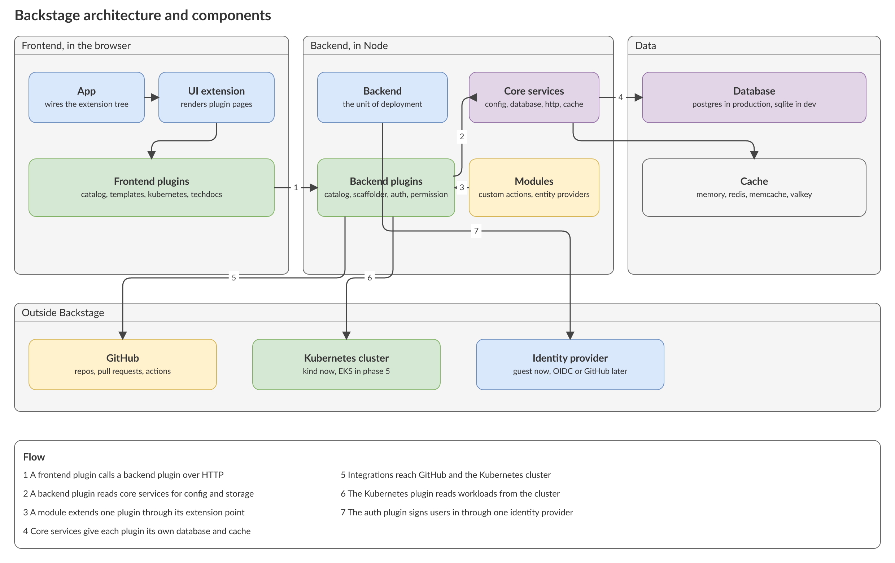
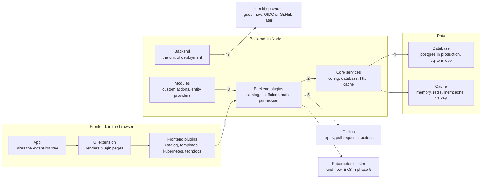
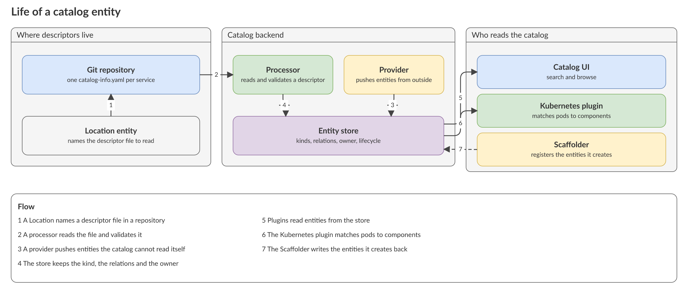
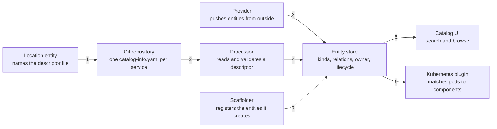
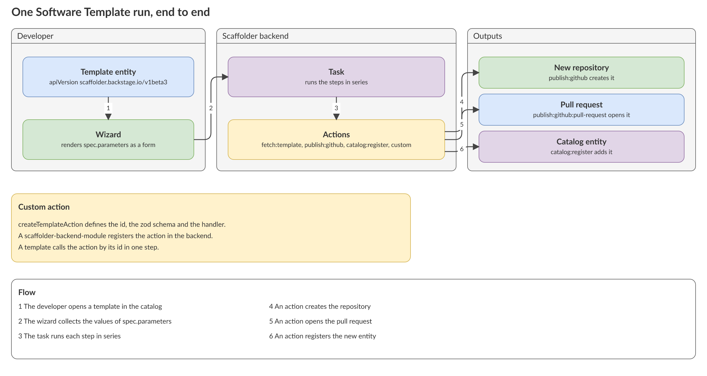
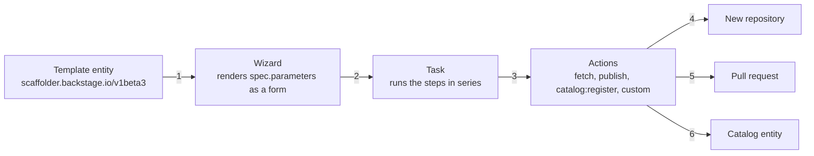
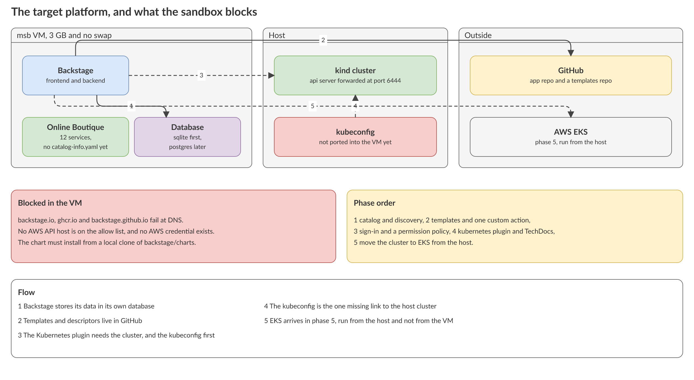
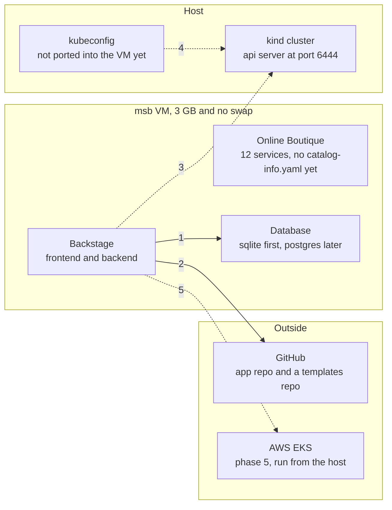

# Backstage as an internal developer portal: concepts, feasibility and a phased plan

Question: What is Backstage, and how do its parts fit together? Can we run it here as an internal developer portal for a platform-engineering learning project? The project uses a local kind cluster and the Google Online Boutique app now. It uses AWS EKS later. The reader is an infrastructure engineer who learns a system from its diagrams first.

Source: the `docs/` tree of `backstage/backstage` at commit `c0ea0569801f93f5421d3233915dda1a281f06ed`, the chart in `backstage/charts` at `9be4bcfa92ea5f35d770597f815f50636cb8e75b`, and `GoogleCloudPlatform/microservices-demo` at `c7cb6d5bfd6ea3aed768634ebbcb98cb7a523712`. Research date: 2026-10-30. Local repo state: `main` at `80619f6`.

Evidence tags: **[primary]** means the Backstage project or Google wrote it and I read the text. **[repo]** means a file in this repo. **[inference]** means my own conclusion and no source states it. **[blocked]** means I tried to read it and the sandbox refused.

**Status:** `backstage.io` is DNS-blocked in this sandbox, so no claim below cites it. Every Backstage claim cites the docs tree in the GitHub repository instead. That tree is the source that `backstage.io/docs` renders.

## Verdict

1. Backstage is a framework for building developer portals, not a finished product. The Software Catalog is its centre. [primary]
2. The four areas you named all exist upstream, and each exposes a documented extension point. The areas are the catalog, the Scaffolder, the permission framework and the plugin systems. [primary]
3. Research and a local install are feasible in this sandbox today. The sandbox blocks two hosts that Backstage users normally rely on, so the Helm chart must install from a local clone. [repo] [inference]
4. Real AWS EKS is not feasible from this VM. Three independent things are missing: an AWS credential, an allowed AWS API host and the AWS CLI. [repo]
5. The 3 GB memory cap is the real risk for a local install. The Backstage docs and chart state no memory requirement, so any number here is an estimate. [primary] [inference]
6. Online Boutique ships twelve services and no `catalog-info.yaml`. Writing those descriptors is the first real work, and it is also the best teaching material for the catalog. [primary]

Rejected options:

- A managed IDP product instead of Backstage. It would remove the learning you asked for.
- Real EKS in phase 1. It needs host-side sandbox changes and real AWS spend before you learn anything.
- Prose without diagrams. You asked to see the architecture first, and this repo keeps diagrams as sources.

## 1. What Backstage is

Backstage calls itself "an open source framework for building developer portals". A centralized software catalog powers it. It restores order to microservices and infrastructure, and it lets product teams ship quickly without losing autonomy. [primary] `docs/overview/what-is-backstage.md#L9-L12`

It ships four things out of the box: the Software Catalog, Software Templates, TechDocs, and a plugin ecosystem. [primary] `docs/overview/what-is-backstage.md#L17-L29`

It is a CNCF Incubation project. [primary] `docs/overview/what-is-backstage.md#L31-L33`

The word that matters for your framing is *framework*. You build your portal on it. You do not configure a finished product. [inference]

## 2. Architecture and components

The source is [backstage-architecture.drawio](../diagrams/backstage-architecture.drawio). The same diagram in Mermaid:

Backstage names three main components: the frontend, the backend and the databases. [primary] `docs/overview/architecture-overview.md#L20-L24`

| Concept | What it is | Source |
|---|---|---|
| App | The root of the frontend. It wires extensions together and has no feature of its own. | [primary] `docs/overview/architecture-overview.md`, section "App" |
| Extension | The building block of the frontend tree. Plugins contribute extensions. The app wires them into one tree. | [primary] same file, section "Extensions" |
| Backend | The unit of deployment. You may run one backend with everything, or several smaller ones. | [primary] same file, section "Backend" |
| Backend plugin | A feature. Plugins cannot call each other in code. They talk over the wire, so each plugin is its own microservice. | [primary] same file, section "Backend plugins" |
| Core service | A utility a plugin depends on: logging, database access, config, http, cache. | [primary] same file, section "Services" |
| Extension point | The seam a plugin exposes for customization. Entity providers and custom Scaffolder actions are extension points. | [primary] same file, section "Extension Points" |
| Module | Code that uses one plugin's extension points. It must deploy in the same backend as that plugin. | [primary] same file, section "Modules" |
| Database | One logical database per plugin, through Knex. SQLite serves tests and local runs. PostgreSQL is the preferred production database. | [primary] same file, section "Databases" |
| Cache | One logical cache per plugin. Stores: memory, memcache, redis, valkey, infinispan. | [primary] same file, section "Cache" |

The module and extension-point pair is the single most important idea for your goal. Every custom workflow you write lands in a module that extends one plugin. [inference]

## 3. The Software Catalog

The source is [catalog-entity-life.drawio](../diagrams/catalog-entity-life.drawio). The same diagram in Mermaid:

The catalog models software with three core entities: Components, APIs and Resources. It models people with Users and Groups. It groups them with Systems and Domains. [primary] `docs/features/software-catalog/system-model.md#L14-L24`

A descriptor file is YAML. The project recommends the name `catalog-info.yaml`. [primary] `docs/features/software-catalog/descriptor-format.md#L14-L15` The envelope is `apiVersion`, `kind`, `metadata` and `spec`. A Component carries `spec.type`, `spec.lifecycle`, `spec.owner` and an optional `spec.system`. [primary] same file, section "Kind: Component"

| Term | Role | Source |
|---|---|---|
| Location | An entity that names a descriptor file or a URL. It is how a file in a repository enters the catalog. | [primary] `docs/features/software-catalog/descriptor-format.md`, section "Kind: Location" |
| Processor | Reads descriptor files and validates them. You write one when a new file format must enter the catalog. | [primary] `docs/features/software-catalog/life-of-an-entity.md` |
| Provider | Pushes entities from a system the catalog cannot read as files. You write one for external sources. | [primary] same file |
| Relation | A typed edge between entities, such as `ownedBy` or `dependsOn`. Some are well known. | [primary] `docs/features/software-catalog/well-known-relations.md` |
| Annotation | Namespaced metadata that integrations read, for example `kubernetes.io/api-server`. | [primary] `docs/features/software-catalog/well-known-annotations.md` |

For Online Boutique the honest reading is this: the descriptors must live in a repository you control. A fork of the upstream repo, or a separate catalog repo that points at the services, both work. The catalog only reads files it can reach through a configured integration. [inference]

## 4. Software Templates and custom workflows

The source is [scaffolder-workflow.drawio](../diagrams/scaffolder-workflow.drawio). The same diagram in Mermaid:

A template is a YAML entity with `apiVersion: scaffolder.backstage.io/v1beta3`. Its `spec.parameters` are JSON Schema and render as the wizard form. Its `spec.steps` run in series in the scaffolder backend. Its `spec.output` saves links for the result page. [primary] `docs/features/software-templates/writing-templates.md#L14-L16` and the example that follows

The documented example already is your target workflow: `fetch:template` renders a skeleton, `publish:github` creates the repository, and `catalog:register` adds the new entity. [primary] same example

A custom action is a function that returns `createTemplateAction`. It declares an `id`, a zod schema for input and output, and a `handler`. The naming convention is `provider:entity:verb`. [primary] `docs/features/software-templates/writing-custom-actions.md#L77-L92`

The CLI generates the wrapper: `yarn backstage-cli new`, then choose `scaffolder-backend-module`. The module registers your action in the backend. [primary] `docs/features/software-templates/writing-custom-actions.md#L16-L34`

| Question | Answer | Source |
|---|---|---|
| Where do templates live? | They are catalog entities. You add them like any descriptor, through a Location or a discovery provider. | [primary] `docs/features/software-templates/adding-templates.md` |
| Can I test a template locally? | Yes. The docs describe dry-run testing. | [primary] `docs/features/software-templates/dry-run-testing.md` |
| Can I customize the wizard? | Yes, with custom field extensions and custom step layouts. | [primary] `docs/features/software-templates/writing-custom-field-extensions.md`, `writing-custom-step-layouts.md` |

## 5. Auth, identity and permissions

Backstage splits authentication from authorization. Providers authenticate. The permission framework authorizes. [primary] `docs/auth/index.md#L11`

Seventeen providers ship in the core library, among them GitHub, Google, Okta, Azure, GitLab and a generic OAuth2 proxy. [primary] `docs/auth/index.md#L22-L40`

The guest provider makes every user share one identity. It exists so that permissioned plugins work in development. The docs say guest sign-in helps in non-production and that production should not offer it. [primary] `docs/auth/guest/provider.md#L22` and `docs/auth/index.md#L168`

| Fact | Source |
|---|---|
| By default Backstage endpoints are not protected, and all actions are available to anyone. | [primary] `docs/permissions/overview.md#L9` |
| A policy is code that receives a user and a permission and returns allow or deny. It is not tied to RBAC or ABAC. | [primary] `docs/permissions/concepts.md#L11-L13` |
| Plugins decide nothing by themselves. The policy decides and the plugin enforces. | [primary] `docs/permissions/concepts.md`, section "Policy decision versus enforcement" |
| Rules bind to data and form conditions, so a plugin can push evaluation into its own database query. | [primary] `docs/permissions/concepts.md`, section "Conditional decisions" |

For a one-developer kind install the cheapest real path is the guest provider first. A GitHub OAuth app or a self-hosted OIDC provider follows when you want named users. This repo already deploys Dex elsewhere, and Backstage has no Dex-specific provider. A generic OIDC provider would serve. [inference]

## 6. Plugins, the frontend system and deployment

The docs recommend migrating frontend plugins to the new frontend system, and say to do so under an `/alpha` sub-path export. [primary] `docs/frontend-system/index.md#L10-L11` So the new system is the direction, and its exports are still alpha. Learn the concepts of the new system, and expect to read classic plugin code in the wild. [inference]

A plugin takes up to five packages: two frontend, two backend and one isomorphic. [primary] `docs/overview/architecture-overview.md`, section "Plugin Packages"

| Deployment fact | Value | Source |
|---|---|---|
| Chart version | 2.10.2 | [primary] `backstage/charts` `charts/backstage/Chart.yaml` |
| Default image | `backstage/backstage`, tag `latest`, from Docker Hub | [primary] `charts/backstage/values.yaml#L153-L156` |
| Bundled database | A Bitnami `postgresql` subchart from `oci://registry-1.docker.io/bitnamicharts`, behind `postgresql.enabled` | [primary] `charts/backstage/Chart.yaml`, dependencies |
| Default resources | `resources: {}`, so no requests and no limits | [primary] `charts/backstage/values.yaml#L238` |
| Local install database | In-memory SQLite with demo content. The docs call it not production-ready. The client is `better-sqlite3`. | [primary] `docs/getting-started/index.md#L18`, `docs/getting-started/config/database.md#L79` |

The Kubernetes plugin reads clusters through locator methods. The valid ones are `catalog`, `config`, `gke`, `localKubectlProxy` and a custom supplier. [primary] `docs/features/kubernetes/configuration.md#L150-L160` There is no `aws` locator upstream. The EKS phase therefore needs either a `catalog` Resource with the right annotations, or a custom supplier. [primary] [inference]

## 7. Feasibility in this sandbox

The source is [idp-target-platform.drawio](../diagrams/idp-target-platform.drawio). The same diagram in Mermaid:

| Item | State here | Source |
|---|---|---|
| `backstage.io`, `backstage.github.io`, `ghcr.io` | Blocked at DNS. The chart cannot use `helm repo add`. Install from a local clone of `backstage/charts` instead. | [repo] `.msb/sandbox.yaml` `network.allow`, [blocked] |
| `registry.npmjs.org`, `registry-1.docker.io`, `github.com` | Allowed. `create-app`, the chart dependencies and the default image all pull. | [repo] `.msb/sandbox.yaml` |
| AWS API hosts and AWS credentials | Absent. No `sts` or `eks` host is on the allow list, no AWS key exists, and the image has no AWS CLI or eksctl. | [repo] `.msb/sandbox.yaml`, `.msb/dev-tools/tools/infra.toml` |
| kind cluster | Runs on the host. Its API server reaches the VM at port 6444, but the kubeconfig is not ported, so nothing in the VM uses it yet. | [repo] `.msb/README.md` |
| Memory | 3 GB and no swap. A process above the cap dies. | [repo] `.msb/sandbox.yaml` |
| Online Boutique | Twelve service directories at `c7cb6d5`. No `catalog-info.yaml` anywhere. | [primary] `GoogleCloudPlatform/microservices-demo` |

The memory question, stated honestly: the Backstage docs and the chart state no memory or CPU requirement. A dev-mode backend plus frontend plus SQLite fits in about 1.5 GB in common practice, but that number is mine and not the project's. Measure it in phase 1 before adding the Boutique services to the same VM. [inference]

## 8. The phased plan

Each phase ends with a gate you can see. No phase starts before the previous gate passes.

| Phase | Work | Gate |
|---|---|---|
| 1 Catalog | Install Backstage from a local chart clone with SQLite. Write twelve `catalog-info.yaml` files for Online Boutique plus one System and one Group. Ingest them through a Location. | The catalog UI lists twelve components under one system. |
| 2 Templates | Add one template that renders a thirteenth service, publishes a repository and registers it. Then add one custom action in a `scaffolder-backend-module` that writes a file the skeleton needs. | One template run creates a repo, a pull request and a catalog entity. |
| 3 Identity | Turn on the guest provider. Then write one permission policy that denies template execution to a second guest-like user. | The policy decision appears in the backend log. |
| 4 Cluster view | Port the kind kubeconfig into the VM. Add a `kubernetes-cluster` Resource with the `kubernetes.io/*` annotations. Enable the Kubernetes plugin and TechDocs. | The catalog page of one component shows its pods. |
| 5 EKS | On the host, create the cluster and move the workloads. Replace the cluster locator with a catalog Resource that points at EKS. | The Kubernetes plugin shows EKS pods while Backstage still runs where it ran. |

Phase 5 runs on the host because the VM cannot reach AWS. That is a sandbox boundary, not a Backstage limit. [repo] [inference]

## Gaps and conflicts

- No primary source states a memory or CPU requirement for Backstage. Every sizing number in this document is an inference.
- The chart has no `appVersion`. Its default image tag is `latest`, so a plain install is not reproducible. Pin the tag in phase 1.
- The sandbox blocked `backstage.io`, so I could not compare the rendered docs with the repository tree. I assume they match, because the site renders this tree. [inference]
- The Kubernetes plugin has no AWS locator. I did not test whether a community module adds one.
- I did not run any install. Every feasibility claim about running Backstage here rests on the allow list and the tool list, not on a trial.

## Open questions

1. Should the descriptors live in a fork of Online Boutique, or in a separate catalog repository? The fork keeps descriptors next to code. The separate repo avoids touching upstream.
2. Should phase 3 use a GitHub OAuth app or a self-hosted Dex? Dex reuses work this repo already did. GitHub needs one OAuth app and no new infrastructure.
3. Should the host allow `backstage.io` and `ghcr.io` so the normal `helm repo add` path works? The command is `just msb allow-host <host>` on the host, then a new VM.
