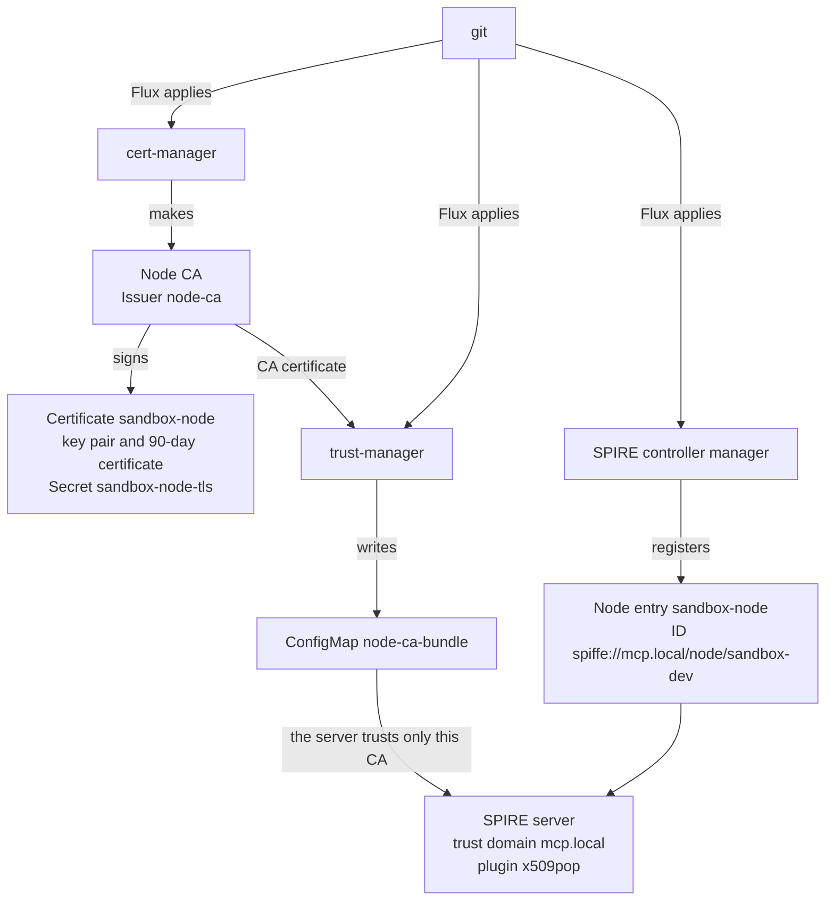
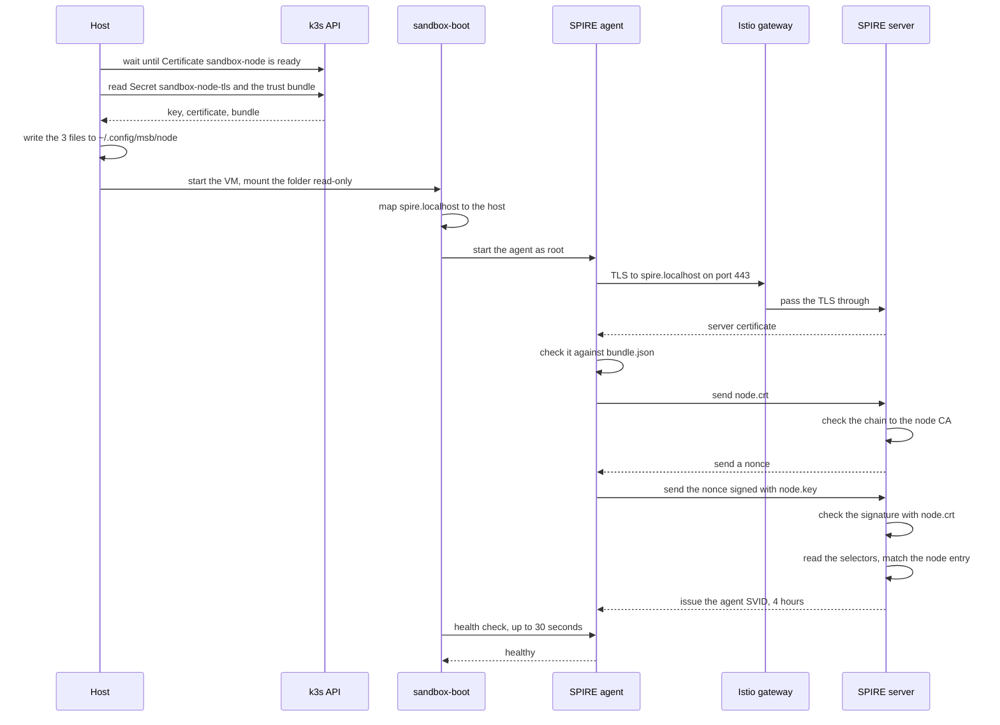
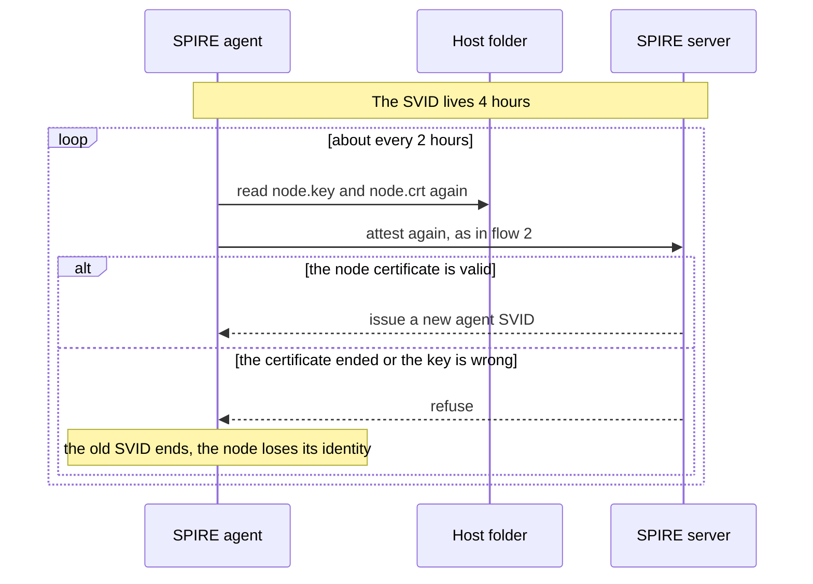

# Node attestation of the sandbox microVM

Question: How does the microVM prove to the SPIRE server that it is an approved node? Is this in line with zero trust? What is still open?

Source: the repo files (read), the live cluster and the live sandbox (checked), and the SPIRE documentation. Research date: 2026-11-05. Local repo state: `main` at `004569f`.

Evidence tags: **[repo]** is a file in this repo. **[live]** is something I ran on the cluster or in the sandbox. **[spire]** is a SPIRE document. **[inference]** is my own conclusion.

This document replaces the first version. That version described a join token and the kind cluster. The join-token model now exists only in the `docker-sbx` tag.

The lists and the diagrams are narrow on purpose. They read well in the GitHub mobile app.

## Verdict

1. Node attestation works. The SPIRE agent in the microVM attested with `x509pop`, through the gateway of the k3s cluster. [live]
2. The node certificate comes from outside the VM. cert-manager makes the key pair and the certificate before the VM starts. [repo]
3. The proof says that the operator approved this node. It does not say anything about the state or the image of the VM. [inference]
4. The node identity does not block any call yet. The VM has the node entry and no workload entry. [live]

## The picture


The letters a to d are the prerequisites. Flux applies them once, from git. The numbers 1 to 6 happen at each `just msb run`. The panel below the diagram repeats the steps in words.

## The names

- **`mcp.local`** is the trust domain. It is the name of the identity space of this stack. Every ID starts with `spiffe://mcp.local`. The setting `trust_domain` in `config/cloud/k3s/identity.yaml` sets it. The value is true only for the local cluster. [repo]
- **SPIFFE ID** is the name of an identity. Example: `spiffe://mcp.local/node/sandbox-dev`.
- **SVID** is the short-lived certificate that SPIRE issues for a SPIFFE ID. The agent SVID lives 4 hours. [live]
- **SPIRE server** keeps the registration entries and issues the SVIDs. It runs in the cluster.
- **SPIRE agent** runs on the node. It attests the node to the server. Later it serves SVIDs to the workloads of the node.
- **Node attestation** is the proof that the operator approved a node. Here the proof is a certificate and its key. The plugin is `x509pop` (proof of possession of an x509 key). [spire]
- **Node CA** signs the node certificate. It is not the CA of SPIRE. [repo]
- **Node CA bundle** holds the certificate of the node CA. The server uses it to check node certificates.
- **Trust bundle** (`bundle.json`) holds the certificates of the trust domain. The agent uses it to check the server. The two bundles are different files.
- **Nonce** is a random value. The server sends it. The agent signs it with the node key. This proves that the agent holds the key. [spire]
- **Selector** is a fact that the server learns about the node. Here: the CN of the certificate and the login in its URI SAN. [repo]
- **Node entry** is a registration entry. It gives an attested node a fixed ID, picked by the selectors. Workload entries use it as parent. [repo]
- **`spire.localhost`** is the name that the agent calls. The gateway picks the route by this name. `sandbox-boot` maps it to the host. [repo]
- **TLS passthrough** means that the gateway does not open the TLS. The agent and the server do the handshake with each other. [repo]

## The parts

- **Node CA** (cluster, `spire-system`). cert-manager makes it. [repo]
- **ConfigMap `node-ca-bundle`** (cluster). trust-manager copies the CA certificate into it. The server reads it. [repo]
- **Certificate `sandbox-node`** (cluster). cert-manager makes the ECDSA key pair and the 90-day certificate. It keeps both in the Secret `sandbox-node-tls`. [repo]
- **Node entry `sandbox-node`** (cluster). The kind is `ClusterStaticEntry`. The file is `platform/addons/spire/node-entry.yaml`. The controller manager of SPIRE registers it in the server. [repo]
- **SPIRE server** (cluster). Checks the certificate and the proof. Issues the agent SVID. [spire]
- **Istio ingress gateway** (cluster). Takes the TLS on port 443 and passes it through to the server. [repo]
- **`just msb node-cert`** (host). Waits until the certificate is ready. Copies the key, the certificate and the trust bundle to `~/.config/msb/node`. [repo]
- **`~/.config/msb/node`** (host, mounted in the VM). The VM sees it read-only at `/run/sandbox/node`. The key file has mode 600. [repo]
- **`sandbox-boot`** (microVM). Maps `spire.localhost` to the host. Starts the agent as root. Waits up to 30 seconds until the agent is healthy. [repo]
- **SPIRE agent** (microVM). Reads the key and the certificate. Proves that it holds the key. [repo]

## Where the node entry is

The entry is an object in git: `ClusterStaticEntry` `sandbox-node`. Flux applies it. The controller manager of SPIRE copies it into the server. [repo]

The live server shows it. [live]

```text
Entry ID   : mcp-guardrails.15029222-9bc5-4d88-ae6e-68d045a39ef9
SPIFFE ID  : spiffe://mcp.local/node/sandbox-dev
Parent ID  : spiffe://mcp.local/spire/server
Selector   : x509pop:san:github-id:raghav19
Selector   : x509pop:subject:cn:sandbox-dev
```

The agent has its own ID: `spiffe://mcp.local/spire/agent/x509pop/<hash of the certificate>`. It changes with each new certificate. The node entry gives the node a second ID that stays the same. [repo]

## Flow 1: the prerequisites

Flux applies these objects once. After that, nobody does anything by hand.



## Flow 2: one attestation, at the start of the VM



If the agent is not healthy after 30 seconds, `sandbox-boot` stops. Then `just msb run` fails and prints the agent log. [repo]

## Flow 3: attesting again, about every 2 hours

The agent SVID lives 4 hours. About half-way, the agent rotates it. The `x509pop` plugin allows re-attestation, so the rotation runs the full attestation again. [spire] [live]



The time of 2 hours comes from the SVID life and the half-way rule. I did not see a second attestation yet. The agent attested at 19:16 UTC, so the first one is due near 21:16 UTC. [inference]

## What the flow proves

- A caller needs two things: a certificate that the node CA signed, and the matching key. A network position gives no trust. [spire]
- Only the host folder and the Secret hold the key. The agent runs as root, so the user `agent` (Claude Code) cannot read the key. [repo]
- The gateway does not open the TLS. The agent and the server do the handshake with each other. [repo]

## What the flow does not prove

- The state of the VM. Any VM that holds the three files passes the check. [inference]
- That the VM runs the expected image. [inference]

## Lifetimes

- The node certificate lasts 90 days. cert-manager renews it 30 days before the end and makes a new key. [repo]
- The host folder gets the new files only when `just msb node-cert` runs. That happens at each `just msb run`. A VM that runs for 90 days without a new run ends up with an expired certificate. [inference]
- The agent SVID lasts 4 hours on this server (`default_x509_svid_ttl`). [live]
- The agent reads the key and the certificate again at each attestation. So the node certificate must be valid at all times. [spire] [repo]
- A forced rotation (a leaked key) is a separate step. Delete the Secret `sandbox-node-tls`, then run `just msb node-cert`. [repo]

## What is open

1. Add a workload entry for a process in the VM. Use the node ID as parent and a `unix` selector. [inference]
2. Put an SVID on the client hop, and add a gateway rule on the SPIFFE ID. [inference]
3. The VM mounts the k3s admin kubeconfig. Replace it with a scoped one. [repo]

## Gaps

- I did not see a re-attestation. The agent was only minutes old.
- The agent log is readable by root only. I read the server log and the agent list of the server.
- I did not test an expired node certificate.
- I did not check whether the server refuses the old certificate after a forced rotation.
