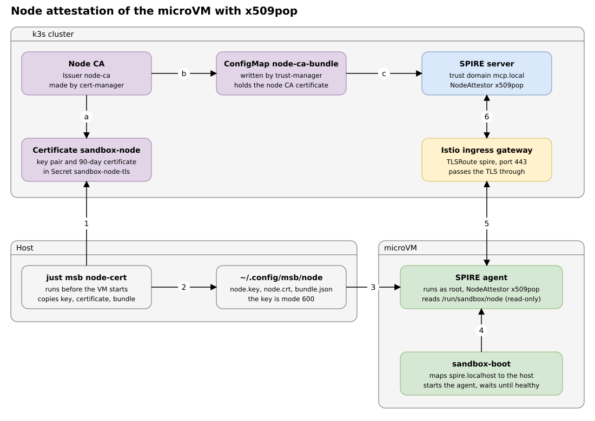
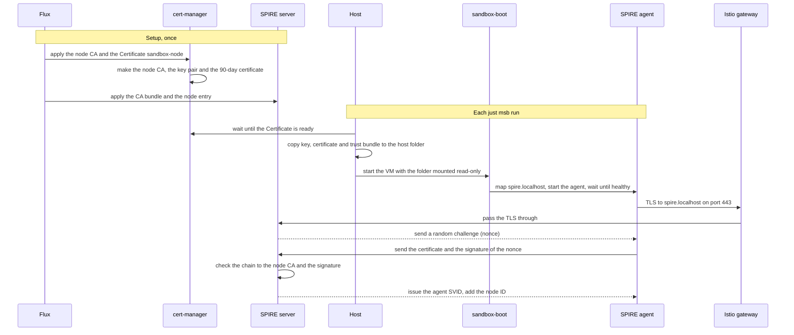

# Node attestation of the sandbox microVM

Question: How does the microVM prove to the SPIRE server that it is an approved node? Is this in line with zero trust? What is still open?

Source: the repo files (read), the live cluster and the live sandbox (checked), and the SPIRE documentation. Research date: 2026-11-05. Local repo state: `main` at `004569f`.

Evidence tags: **[repo]** is a file in this repo. **[live]** is something I ran on the cluster or in the sandbox. **[spire]** is a SPIRE document. **[inference]** is my own conclusion.

This document replaces the first version. That version described a join token and the kind cluster. The join-token model now exists only in the `docker-sbx` tag.

## Verdict

1. Node attestation works. The SPIRE agent in the microVM attested with `x509pop`, through the gateway of the k3s cluster. [live]
2. The node certificate comes from outside the VM. cert-manager makes the key pair and the certificate before the VM starts. [repo]
3. The proof says that the operator approved this node. It does not say anything about the state or the image of the VM. [inference]
4. The node identity does not block any call yet. The VM has the node entry and no workload entry. [live]

## The picture

The letters a to c are the setup. Flux applies it once, from git. The numbers 1 to 6 happen at each `just msb run`.

## The parts

| Part | Where | Job |
|---|---|---|
| Node CA | cluster, `spire-system` | cert-manager makes it. It signs the node certificate. The SPIRE server trusts only certificates that it signed. [repo] |
| ConfigMap `node-ca-bundle` | cluster | trust-manager copies the CA certificate into it. The SPIRE server reads it. [repo] |
| Certificate `sandbox-node` | cluster | cert-manager makes the ECDSA key pair and the 90-day certificate. It keeps both in the Secret `sandbox-node-tls`. [repo] |
| `just msb node-cert` | host | Waits until the certificate is ready. Copies the key, the certificate and the trust bundle to `~/.config/msb/node`. [repo] |
| `~/.config/msb/node` | host, mounted in the VM | The VM sees it read-only at `/run/sandbox/node`. The key file has mode 600. [repo] |
| `sandbox-boot` | microVM | Maps `spire.localhost` to the host. Starts the agent as root. Waits up to 30 seconds until the agent is healthy. [repo] |
| SPIRE agent | microVM | Reads the key and the certificate. Proves to the server that it holds the key. [repo] |
| Istio ingress gateway | cluster | Takes the TLS on port 443 and passes it through to the server. It picks the route by the name `spire.localhost`. [repo] |
| SPIRE server | cluster | Checks the certificate and the proof. Issues the agent SVID. [spire] |
| Node entry `sandbox-node` | cluster | Gives an attested node the fixed ID `spiffe://mcp.local/node/sandbox-dev`. The selectors are the CN `sandbox-dev` and the URI SAN with the GitHub login. [repo] |

## The flow

## What the flow proves

- A caller needs two things: a certificate that the node CA signed, and the matching key. A network position gives no trust. [spire]
- Only the host folder and the Secret hold the key. The agent runs as root, so the user `agent` (Claude Code) cannot read the key. [repo]
- The gateway does not open the TLS. The agent and the server do the handshake with each other. [repo]

## What the flow does not prove

- The state of the VM. Any VM that holds the three files passes the check. [inference]
- That the VM runs the expected image. [inference]

## Lifetimes

- The node certificate lasts 90 days. cert-manager renews it 30 days before the end and makes a new key. `just msb node-cert` copies the new files at the next run. [repo]
- The agent SVID lasts 4 hours on this server (`default_x509_svid_ttl`). [live]
- The `x509pop` plugin allows re-attestation. The agent attests again when it rotates its SVID. It reads the key and the certificate again each time. So the node certificate must be valid at all times. [spire] [repo]
- A forced rotation (a leaked key) is a separate step. Delete the Secret `sandbox-node-tls`, then run `just msb node-cert`. [repo]

## What is open

1. Add a workload entry for a process in the VM. Use the node ID as parent and a `unix` selector. [inference]
2. Put an SVID on the client hop, and add a gateway rule on the SPIFFE ID. [inference]
3. The VM mounts the k3s admin kubeconfig. Replace it with a scoped one. [repo]

## Gaps

- I did not see a re-attestation. The agent was only minutes old.
- The agent log is readable by root only. I read the server log and the agent list of the server.
- I did not test an expired node certificate.
- I did not check whether the server refuses the old certificate after a forced rotation.
